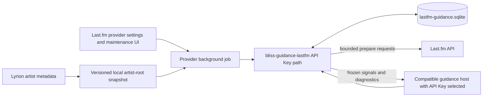
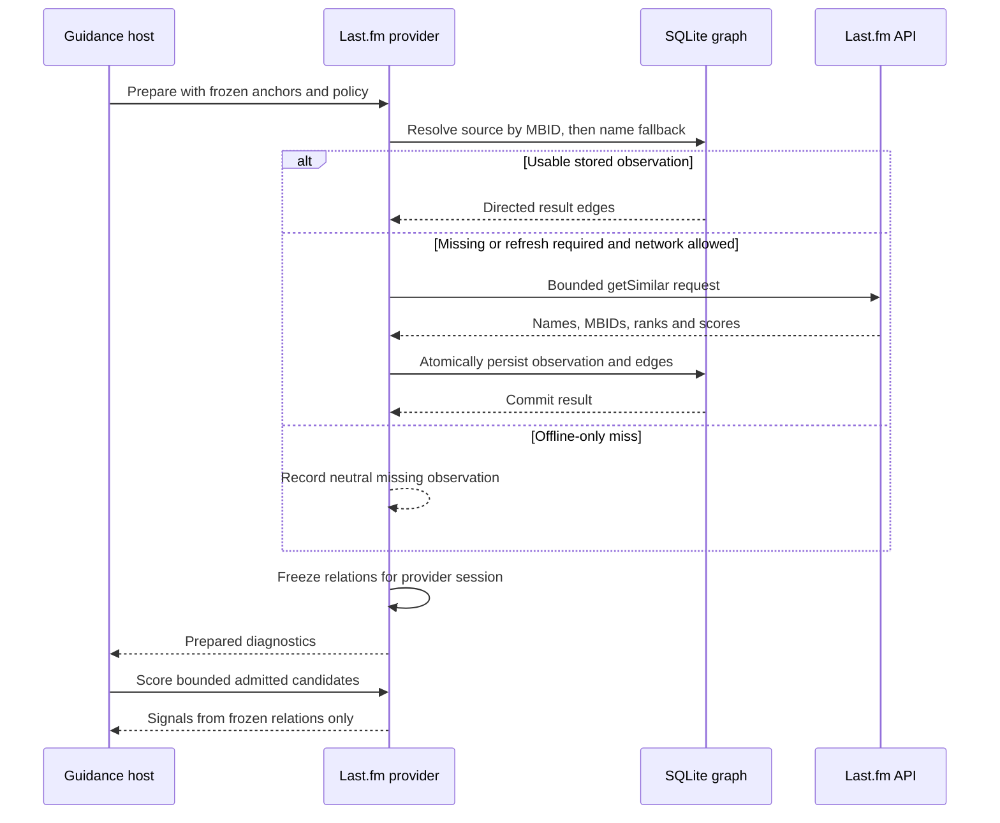

# Last.fm offline guidance graph design

**Status:** Approved design; local implementation complete, release and Pi acceptance pending
**Scope:** API-key-only persistent Last.fm artist-similarity graph, read-through
acquisition, offline operation, and library-wide artist synchronization  
**Last reviewed:** 2026-10-22  

## Purpose

The Last.fm guidance provider's direct **API Key** path currently keeps a
bounded JSON TTL cache for the source anchors needed by one guidance job. This
design replaces that cache with a provider-owned SQLite store that can support
three related uses:

- reuse every successful online lookup in later jobs;
- prefetch similar-artist data for all artists in the current Lyrion library;
- run guidance without network access when the required observations have
  already been stored.

The store must preserve MusicBrainz identifiers, must retain non-library result
artists by default, and must keep Last.fm observations separate from Lyrion's
own metadata. Hosts remain Bliss-first: the graph contributes secondary
guidance only for candidates that the host has already admitted.

This is deliberately an **API-key-only design**. Selecting **LastMix** retains
the existing job-specific resolved-artifact flow. LastMix does not open, read,
populate, refresh, migrate, maintain, or report the SQLite graph described
here.

## Success criteria

- A successful API-key lookup is transactionally available to the next offline
  job without repeating the request.
- Server-side changes are detected through HTTP validators where available and
  through a canonical ordered-result hash after a successful revalidation.
- Artist and recording MBIDs are stored and used before normalized-name
  fallbacks.
- Similarity observations remain directional; `A -> B` never invents `B -> A`.
- Library synchronization queries only the bounded set of local root artists
  and does not recursively crawl every returned artist.
- Non-library result artists are retained by default; an explicit setting may
  restrict persistence to current local targets.
- A dedicated database plus its journal and legacy cache stay below an
  operational 80 MB budget and therefore leave headroom below Last.fm's current
  100 MB reasonable-usage cap.
- Normal provider scoring remains network-free after `prepare` has frozen the
  observations for the job.
- Missing data, an unavailable network, rate limiting, a damaged store, or a
  failed persistence attempt never weakens Bliss eligibility or hard repeat
  constraints.

## Non-goals

- Do not ship a pre-populated Last.fm database.
- Do not recursively crawl artists that appear only as Last.fm results.
- Do not turn Last.fm similarity into an admission rule or acoustic distance.
- Do not add provider-specific code to Better Call Bliss, Bliss Mixer Lab,
  `bliss-playlist-optimizer`, or `bliss-mixer`.
- Do not reuse AudioScrobbler credentials or place an API key in an artifact,
  command line, log, diagnostic, or SQLite database.
- Do not bulk-prefetch similar tracks. Normal job-time track lookups may use the
  same read-through store.
- Do not integrate LastMix with the offline graph. Any future LastMix-backed
  persistence would require its own design and is not implied by this one.

## Considered approaches

| Approach | Advantages | Drawbacks | Decision |
| --- | --- | --- | --- |
| Extend the JSON TTL cache | Small initial change | Whole-file reads and rewrites, weak concurrency, no efficient status or incremental synchronization | Rejected |
| Provider-owned SQLite graph | Indexed lookup, atomic updates, bounded memory, resumable synchronization and explicit provenance | Requires schema migration and maintenance commands | Selected |
| Dedicated graph database | Native graph traversal | Unsuitable deployment footprint and operational complexity for Lyrion appliances | Rejected |

## Ownership and boundaries

| Component | Responsibility |
| --- | --- |
| `lms-guidance-lastfm` | Provider settings, API-key ownership, Lyrion artist-root snapshot, API-key-only background-job lifecycle, status and user-facing maintenance actions |
| `bliss-guidance-lastfm` | API-key-only SQLite schema and migration, direct Last.fm HTTP client, read-through acquisition, graph lookup, synchronization command, size/rate controls and structured diagnostics |
| `bliss-playlist-guidance-spi` | Existing provider lifecycle and score contract; no protocol revision is expected |
| Guidance hosts | Provider discovery, opt-in, bounded candidate batches, Bliss-first policies and established result/log rendering |
| `bliss-similarity-design` | Cross-component design, implementation plan and historical status |

The database lives beneath the Last.fm provider's trusted LMS cache directory.
Only provider-owned code supplies the native path. Web forms and host request
payloads cannot select an executable, database, endpoint, or credential path.

## Static architecture



The root snapshot is a provider-owned, versioned input containing only the
distinct Lyrion artist identities needed for synchronization. It is not a copy
of the decoded Bliss library and contains no Last.fm data or credential.

## The store is a directed graph

`artist.getSimilar(A)` returns a ranked result list. Last.fm does not promise
that `artist.getSimilar(B)` contains `A`, nor that the two scores or ranks are
equal. Top-result truncation alone can make the visible relationship
asymmetric. The store therefore treats every observation as a directed edge:

```text
A -- score 0.82, rank 4 --> B
B -- score 0.61, rank 17 --> A
```

The second edge exists only after an independent lookup of `B`. If both edges
exist, status and diagnostics may report a reciprocal pair, but initial
guidance continues to use the observed direction. No synthetic reverse edge or
combined score participates in selection.

Library artists form the synchronization root set. Returned artists become
stored target nodes by default, including targets absent from Lyrion. A target
is queried as another source only when it independently belongs to the current
root set. This produces a useful bounded graph without recursive expansion.

## Identity model

An artist node stores:

- the canonical display name returned or supplied for the observation;
- a normalized-name fallback;
- an optional canonical lower-case Artist MBID;
- first-seen and last-seen timestamps; and
- origin flags distinguishing a Lyrion root from a Last.fm-only target.

Identity resolution follows this order:

1. a valid Artist MBID;
2. an existing unambiguous alias association;
3. a normalized-name fallback node.

A later MBID may be associated with a name-only node only when the association
is unambiguous. Distinct MBIDs sharing one display name remain distinct. A
name-only lookup that maps to multiple MBID nodes remains a separate fallback
identity instead of guessing.

Track read-through entries use the same principles with Recording MBID first
and normalized artist/title second. Track bulk synchronization is out of scope.

## SQLite schema

The first schema contains logically separate artist and track areas so the
artist synchronization feature does not force a generic, opaque entity model:

```text
metadata
  schema_version
  created_at
  migrated_from_json_at

artists
  artist_id
  artist_mbid
  canonical_name
  normalized_name
  first_seen_at
  last_seen_at

artist_aliases
  artist_id
  alias_kind
  display_value
  normalized_value

artist_queries
  query_id
  source_artist_id
  fetched_at
  validated_at
  changed_at
  expires_at
  etag
  last_modified
  payload_hash
  acquisition_source
  requested_limit
  actual_result_count
  result_status

artist_similarity_edges
  query_id
  target_artist_id
  rank
  match_score

library_snapshots
  snapshot_id
  library_identity
  created_at

library_artist_membership
  snapshot_id
  artist_id

tracks
  track_id
  recording_mbid
  artist_id
  canonical_title
  normalized_title

track_queries
  query_id
  source_track_id
  fetched_at
  validated_at
  changed_at
  expires_at
  etag
  last_modified
  payload_hash
  acquisition_source
  requested_limit
  actual_result_count
  result_status

track_similarity_edges
  query_id
  target_track_id
  rank
  match_score
```

Partial unique indexes protect non-empty MBIDs. Lookup indexes cover normalized
names, source identities, current query snapshots, expiry, and library
membership. One transaction replaces the current outgoing result set for a
source; readers never observe half an API response.

Successful empty results are stored as negative observations. Transport or API
failures are not negative observations and do not replace a previous usable
result.

The payload hash covers the method, source identity and ordered result tuples.
An artist tuple contains target MBID or fallback identity, rank and normalized
similarity score. The requested limit is stored separately so increasing it
does not look like a server-side similarity change when Last.fm returns the
same list. A changed rank or score remains observable even when the returned
artist membership is identical.

`fetched_at` records the latest complete `200` response, `validated_at` records
the latest successful `200` or `304` validation, and `changed_at` records the
latest response whose canonical payload hash differed from the stored graph.

## Retrieval policies

The provider owns one global retrieval policy:

| Policy | Stored fresh data | Stored stale data | Missing data | Network |
| --- | --- | --- | --- | --- |
| **Online with cache** | Use | Revalidate before use | Fetch and persist | Allowed |
| **Offline preferred** | Use | Use immediately and queue refresh | Fetch and persist | Allowed only for refresh/miss |
| **Offline only** | Use | Use as an explicitly stale snapshot | Return neutral guidance | Never |

The retrieval policy is provider-owned rather than host-overridable. Existing
host overrides for scoring influence and Last.fm source remain independent.

The persistent graph is available exclusively through the **API Key** source.
The **LastMix** source keeps its current job-specific resolved-artifact path and
never accesses the SQLite graph. A future LastMix graph integration would need
a separate design; this document neither requires nor anticipates one.

Provider UI behavior:

- graph and synchronization controls are shown and enabled only for **API
  Key**; they are absent when **LastMix** is selected;
- **Store all returned artists** is the default scope;
- **Store only artists in the current Lyrion library** is the optional scope;
- **Similar artists stored per source** offers `25`, `50`, and `100`, with `25`
  preserving the current default until live API and storage measurements
  justify a larger default;
- changing the scope affects new and refreshed observations; an explicit
  compact/rebuild action applies it to already stored data;
- normal online misses always use read-through persistence when graph storage
  is enabled.

## Job-time read-through flow



The API response is committed before it is considered durably available. If
the commit fails, the current job may use the already parsed in-memory result,
but diagnostics must report `persistence_failed`; it must not claim an offline
cache fill.

`score` never opens a network connection. It matches candidate Artist MBIDs or
Recording MBIDs first and falls back to the normalized metadata already carried
by the SPI.

## Library synchronization flow

The provider settings page starts a provider-owned background job. The Perl
plugin captures a stable distinct-artist snapshot from the current Lyrion
library, including all available Artist MBIDs and names. It then invokes a
native maintenance command with trusted paths and the API key supplied only in
the existing process environment.

The native command:

1. validates the versioned root snapshot;
2. resolves or creates all local root identities;
3. marks current library membership in one snapshot transaction;
4. skips usable roots already in the graph at the configured result limit;
5. processes missing or refresh-eligible roots under a bounded request budget;
6. persists each complete response transactionally;
7. emits versioned JSONL progress and sanitized diagnostics; and
8. leaves enough state to resume after cancellation, restart or rate limiting.

The default worker count is one and the default request rate is at most one API
call per second. Error 29, HTTP 429, or a `Retry-After` response pauses the job.
Retries use bounded exponential backoff with jitter. UI cancellation stops
before taking another root and never rolls back already committed responses.

Synchronization never starts implicitly inside a normal preview or DSTM mix.
Users start it manually; a later optional schedule may run after a completed
Lyrion scan when no other scan or synchronization job is active.

## HTTP freshness and read-through persistence

The HTTP client retains `Cache-Control`, `Expires`, `ETag` and `Last-Modified`
when Last.fm supplies them. Revalidation uses conditional requests where the
endpoint supports them:

- `304 Not Modified` updates `validated_at` and `expires_at` without replacing
  any edges;
- a `200` response is normalized and compared with `payload_hash`;
- an unchanged `200` updates `fetched_at`, validation, expiry, requested limit,
  and actual count without rewriting edges or changing `changed_at`;
- a changed `200` atomically replaces the outgoing edges and updates
  `fetched_at`, `validated_at`, `changed_at`, and `payload_hash`.

Last.fm exposes no documented similarity revision, change token, webhook, or
push notification. Without an online revalidation, the provider can report only
the age and last successful validation of an observation; it cannot know that
Last.fm changed the list.

When no usable cache header is present, the provider applies these documented
fallback intervals:

- 30 days for a successful non-empty artist-similarity response;
- 7 days for a successful empty response; and
- 24 hours for a successful job-time track-similarity response, preserving the
  current effective host fallback until measured behavior justifies a change.

A stable per-source early-refresh offset between zero and ten percent spreads
background refreshes without extending the advertised maximum freshness. A
newly discovered Lyrion artist or a source without a stored observation is
eligible immediately. The manual update action revalidates expired observations
but still respects rate-limit, request-budget and cancellation policies.

The store retains the last complete observation after freshness expiry so an
explicit offline policy can identify it as stale rather than silently treating
it as fresh. Host traces and provider status distinguish `fresh`, `cached`,
`stale_offline`, `missing`, `partial`, `rate_limited` and
`persistence_failed`.

### Result limits

Last.fm's documented `artist.getSimilar` method accepts an optional `limit` but
does not document a maximum or pagination contract. The current native client
chooses `25`; this is an implementation default rather than a documented API
ceiling. The provider may request `50` or `100`, but must record both the
requested limit and actual returned count instead of assuming the request was
fully honored.

A stored observation is sufficient only when its requested limit is at least
the current configured limit. A fresh 25-result observation is therefore
`incomplete` for a later 50-result request and is eligible for expansion. A
fresh 100-result observation can serve a 25-result consumer by taking its
ordered prefix. Reducing the configured limit does not force a network request
or discard the additional stored edges; the compact/rebuild action may remove
them when the user wants to reclaim space.

Increasing the limit multiplies graph size and may add mostly non-local target
artists. Before changing the default from 25, Raspberry Pi acceptance must
measure actual server response counts, additional local-target coverage,
database growth, synchronization duration, and the 80 MB budget at limits 25,
50, and 100.

## Storage and Last.fm terms

The SQLite graph remains Last.fm data or a derivative work even though it no
longer contains raw JSON. Last.fm's current API terms define data storage
broadly, cap the retained portion of Last.fm data at 100 MB, require caching in
accordance with HTTP response headers, and prohibit bypassing imposed rate
limits:

<https://www.last.fm/api/tos>

The implementation therefore uses a dedicated store and counts, at minimum:

- the SQLite main database;
- its write-ahead log;
- the legacy JSON cache until migration removes it; and
- any provider-created export or backup containing the same observations.

The operational hard stop is 80 MB across those files. The provider checks the
budget before a synchronization batch and after checkpointing. It reports the
current size and refuses additional bulk acquisition before the contractual
cap can be reached. It never attempts to evade the cap through compression,
normalization, hashing or storage-format changes.

Lyrion-owned artist identities and membership are independent local metadata.
Keeping the root snapshot outside the Last.fm database makes the Last.fm-derived
footprint easier to measure and delete.

The public release of **Offline only** using observations beyond HTTP freshness
is gated on written clarification from Last.fm about durable air-gapped use and
whether the 100 MB limit means physical stored bytes or another measurement.
Until then, the behavior may be implemented and tested but must not be described
as generally licensed for indefinite offline retention.

## Migration

On first API-key use after upgrade, and never from the LastMix path, the native
provider:

1. creates and validates the SQLite schema;
2. takes the existing JSON cache lock;
3. imports decodable positive and negative track/artist entries with their
   recorded fetch timestamps and fallback expiry;
4. commits and verifies the imported counts;
5. atomically marks migration complete; and
6. removes the legacy JSON only after successful verification.

A corrupt or unknown JSON cache is ignored with a warning and preserved for
manual inspection; it does not prevent creation of an empty valid SQLite
store. Repeated migration is idempotent.

## User experience

The provider settings page shows:

- Last.fm source and API-key controls already owned by the provider; and
- when **API Key** is selected, retrieval policy, persistence scope, similar
  artists stored per source (`25`, `50`, or `100`), database health and all
  graph-maintenance status and actions described below.

The API-key-only graph section shows the current database size and 80 MB
operating budget; local root coverage; stored external-target, directed-edge
and reciprocal-pair counts; last synchronization status; and **Update offline
data**, **Pause/Resume**, **Cancel**, **Compact/rebuild**, and **Delete offline
data** actions. None of these graph controls or statistics is shown for
LastMix.

Deleting offline data requires explicit confirmation and removes the SQLite
database, WAL, migration cache and provider-created backups. It does not remove
the API key or scoring defaults.

## Logging and diagnostics

Provider logging follows the existing Last.fm category and keeps host rendering
unchanged:

- warning: invalid key, rate limit, damaged store, size limit, failed write or
  failed migration;
- information: synchronization start/finish/pause, root coverage, requests,
  fresh/cache/stale counts, requested/returned result limits, validation
  outcome, changed observations, persisted edges and database size;
- debug: sanitized source identity, MBID/name resolution path, request outcome,
  HTTP validator path, old/new payload hash prefix, returned count, transaction
  result and reciprocal-edge observation.

The API key and unbounded raw responses never appear in logs. Normal jobs emit
aggregate diagnostics and the existing bounded per-request events. Background
synchronization throttles repetitive messages and reports periodic progress
rather than one information line per artist.

## Failure behavior

- Missing API key: synchronization cannot start; existing offline data remains
  readable.
- Network unavailable: online policies use permitted stored observations and
  mark missing sources neutral.
- Rate limit: stop issuing requests, persist resume state and expose the retry
  time.
- SQLite busy: use a bounded busy timeout, then degrade the current job without
  blocking LMS.
- Corrupt database: quarantine by rename, report prominently and require an
  explicit rebuild; never overwrite the only copy silently.
- Size budget reached: complete the current transaction only if it remains
  within budget, then stop acquisition.
- Lyrion rescan: the current synchronization keeps its frozen root snapshot;
  the next run captures the new library identity.
- Cancellation or process termination: committed source responses remain valid;
  the next job resumes from missing roots.

## Performance requirements

- Open the database once per native provider session or maintenance process.
- Use indexed batched reads; never query SQLite once per candidate inside the
  scoring inner loop.
- Keep only relations needed by the current anchors in memory during a normal
  job.
- Stream synchronization roots and commit in small bounded batches.
- Use WAL for concurrent readers with one writer and checkpoint deliberately.
- Avoid `VACUUM` during active playback or a normal guidance job.
- Demonstrate bounded memory with a synthetic 200,000-track library and at
  least 20,000 distinct artist roots.
- Keep normal warm-cache preparation within the existing provider budget;
  library synchronization runs outside preview and DSTM latency paths.

## Acceptance tests

### Identity and graph semantics

- MBID identity wins over conflicting name fallback.
- A name-only result later receiving an unambiguous MBID is linked safely.
- Ambiguous same-name MBID artists are not merged.
- `A -> B` does not create `B -> A`.
- Independently observed reverse edges retain their own scores, ranks and
  timestamps.

### Persistence and policies

- An online miss is available during a second network-blocked run.
- Positive, empty and stale observations remain distinguishable.
- `304 Not Modified` extends validity without rewriting graph edges.
- An unchanged `200` preserves `changed_at`; a changed rank, score or target
  updates it and atomically replaces the source edges.
- Offline-only performs zero HTTP requests.
- A failed SQLite write is visible and is not reported as a cache fill.
- Default scope stores non-library result targets.
- Local-only scope excludes them without changing host eligibility.
- A stored limit of 25 is incomplete for 50, while a stored limit of 100 serves
  25 from its ordered prefix without another request.

### Synchronization and resilience

- The root set is exactly the distinct frozen Lyrion artist snapshot.
- Returned non-library targets do not recursively enter the request queue.
- Cancellation, restart and rate limiting resume without refetching committed
  roots.
- Concurrent normal prepares and one synchronizer preserve database integrity.
- The 80 MB budget stops acquisition before the 100 MB contractual cap.
- API keys and raw credentials are absent from all files, logs and fixtures.

### Migration and host compatibility

- Existing valid JSON entries import once and preserve usable results.
- Corrupt or unsupported JSON does not destroy either file.
- The migration is reachable only when **API Key** is selected.
- Artifact-backed LastMix behavior remains byte-for-byte compatible and causes
  no SQLite open, read, write, migration, maintenance, or graph diagnostics.
- Existing Better Call Bliss preview text and Bliss Mixer Lab selection logs
  remain unchanged except for additional provider cache-state diagnostics where
  their established contracts allow them.

### Raspberry Pi acceptance

- Build the native binaries in the GitHub workflow and verify package
  provenance before deployment.
- Measure cold migration, warm lookup, first read-through and full background
  synchronization resource use.
- Probe requested limits 25, 50 and 100 and record actual returned counts,
  local-target coverage, database growth and synchronization time.
- Confirm LMS UI and queue advancement remain responsive during synchronization.
- Repeat a guidance job with outbound network blocked and verify identical
  frozen Last.fm observations from SQLite.

## Delivery sequence

1. Native SQLite schema, repository API and graph/identity tests.
2. Existing JSON migration and track/artist read-through replacement.
3. HTTP freshness metadata, conditional revalidation and retrieval policies.
4. Provider controls and status for storage policy and database health.
5. Lyrion artist-root snapshot plus resumable native synchronization command.
6. Background-job UI, progress, cancellation and maintenance actions.
7. Size/rate/compliance guards and cross-platform native workflow builds.
8. Host regression tests and Raspberry Pi online-then-offline acceptance.
9. Documentation, changelogs and coordinated native/provider release.

## Release gates

- All repository, provider, migration, failure and host-regression tests pass.
- The packaged binaries declare the required store and synchronization
  capabilities and match their release provenance.
- Pi acceptance demonstrates network-free reuse and acceptable resource use.
- Live API acceptance documents how Last.fm actually handles requested limits
  25, 50 and 100 without treating that observation as a guaranteed API maximum.
- The combined retained Last.fm footprint remains below 80 MB.
- Publicly enabling indefinite stale **Offline only** use requires written
  Last.fm clarification; absence of that clarification must remain explicit in
  provider documentation and UI.
