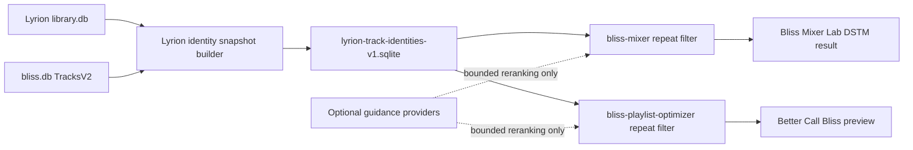
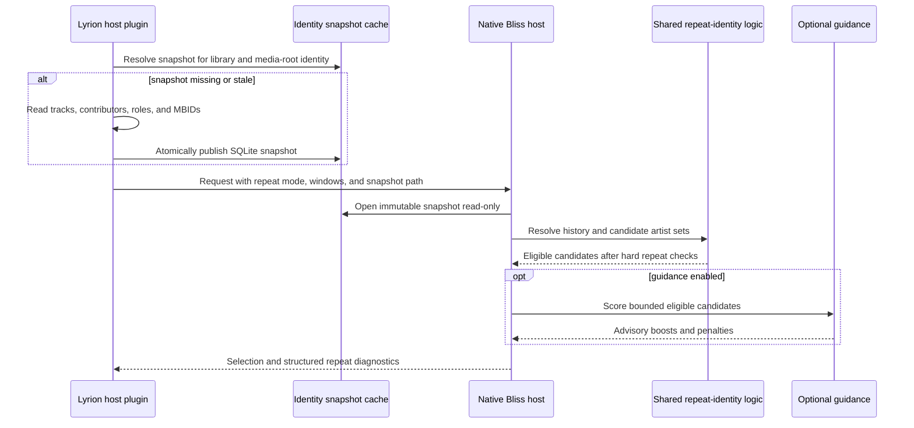

# MBID-aware repeat identity design

**Status:** Implemented and released in both native hosts and Lyrion plugins;
broader performance and fallback verification remains  
**Scope:** Artist identity for hard repeat windows in native Bliss mixing and
playlist optimization  
**Last reviewed:** 2026-10-18  

## Executive summary

Artist repeat windows currently compare one text value. That permits an
obvious repeat when the same artist is credited differently, such as `Queen`
and `Queen & David Bowie`, even when Lyrion knows that both tracks share the
same primary artist and MusicBrainz artist ID.

Repeat checking should use Lyrion's structured artist identities instead. A
Lyrion host captures a reusable, path-keyed identity snapshot. Native Bliss
hosts compare artist-identity sets in this order:

1. MusicBrainz artist ID;
2. Lyrion contributor ID within the captured library snapshot; and
3. a conservatively normalized artist name when neither stable ID exists.

The numeric artist repeat window remains unchanged. A new semantic setting
controls whether the window compares any shared track artist, only Lyrion's
primary artist, or the legacy exact `bliss.db` artist credit. Last.fm and other
guidance remain advisory and can never bypass an identity-based repeat block.

The current implementation covers both native paths: Bliss Mixer Lab supplies
the identity snapshot to `bliss-mixer`, while Better Call Bliss supplies the
same schema to `bliss-playlist-optimizer`. Both native hosts use the shared
repeat-identity implementation in `bliss-mixer-core`.

## Implementation status

| Area | Current status |
| --- | --- |
| Shared Rust identity contract | Implemented and covered by core tests, including MBID, contributor-ID, normalized-name, collaboration, legacy-credit, malformed-MBID, and Various Artists cases. |
| `bliss-mixer` | Accepts the snapshot and policy, reuses a process-local immutable snapshot cache, and applies the identity rule to recent tracks and candidates selected earlier in the same mix. |
| Bliss Mixer Lab | Builds a scan- and media-root-bound SQLite snapshot, exposes the three policies, and sends both fields with each DSTM request. Existing selection-log rendering is unchanged. |
| `bliss-playlist-optimizer` | Loads the hash-bound artifact once and applies the projected identity keys in route, bridge, anchored-path, spacing, extension, and destination-route checks. A missing, mismatched, or invalid artifact reports a structured fallback state and continues with exact Bliss credits. |
| Better Call Bliss | Extends its existing candidate-inventory pass, embeds structured identities for source tracks, supplies the snapshot artifact, and exposes the same global and per-job policy. Its preserved-order and minimum-spacing prechecks use the same policy instead of comparing only display credits. |
| Main-line and release status | The shared core, `bliss-mixer`, Bliss Mixer Lab, `bliss-playlist-optimizer`, and Better Call Bliss changes are on their canonical branches. They are published in `bliss-mixer` v0.11.5, Bliss Mixer Lab 0.10.4 and later, optimizer v0.2.3 and later, and Better Call Bliss 0.22.4 and later. |
| Remaining gates | Extend DBI-backed integration coverage, measure large-library snapshot and lookup performance, and retain the real Queen collaboration case as a live regression check. |

## Existing records reviewed

The `feature/playlist-optimization` branch already contains a substantial
predecessor in
[`PLAYLIST_PREVIEW_FINDINGS_2026-09-24.md`](https://github.com/chrober/bliss-similarity-design/blob/feature/playlist-optimization/PLAYLIST_PREVIEW_FINDINGS_2026-09-24.md).
It identifies canonical recording, release-group, and artist identities as a
P0 concern; proposes complete-credit and shared-artist collaboration policies;
requires the complete Lyrion track-artist contributor set; excludes Various
Artists; and calls for identity-provenance diagnostics. This design retains
those decisions and extends them to the DSTM/native-mixer path, a reusable
identity artifact, shared Rust comparison logic, and coordinated host settings.

The following documents contain relevant existing decisions:

| Existing document | Relevant existing decision | Missing piece addressed here |
| --- | --- | --- |
| [`PLAYLIST_PREVIEW_FINDINGS_2026-09-24.md`](https://github.com/chrober/bliss-similarity-design/blob/feature/playlist-optimization/PLAYLIST_PREVIEW_FINDINGS_2026-09-24.md) | Defines canonical track, album, and artist keys; complete-credit and shared-artist collaboration policies; complete contributor sets; and provenance diagnostics. | It does not define DSTM transport, the shared native implementation, or an efficient reusable Lyrion identity snapshot. |
| [`bliss-playlist-guidance-spi/SPI.md`](https://github.com/chrober/bliss-playlist-guidance-spi/blob/main/SPI.md) | Track anchors can carry `recording_mbid` and `artist_mbids`; stable foreign identifiers are preferred over normalized names. | These fields currently describe guidance context, not hard repeat identity. |
| [`LASTFM_GUIDANCE_ACQUISITION_PLAN.md`](LASTFM_GUIDANCE_ACQUISITION_PLAN.md) | Last.fm resolution uses artist MBIDs first and normalized names only as fallback. | Guidance matching must remain separate from hard artist-repeat matching. |
| [`bliss-playlist-optimizer/docs/ARCHITECTURE.md`](https://github.com/chrober/bliss-playlist-optimizer/blob/main/docs/ARCHITECTURE.md) | Repeat windows are hard route constraints that guidance and variation cannot relax. | Artist equality is still represented by one normalized text key. |
| [`lms-better-call-bliss/ALGORITHMS.md`](https://github.com/chrober/lms-better-call-bliss/blob/main/ALGORITHMS.md) | Artist, album, and track look-back values are hard constraints for generated tracks. | The user-visible meaning of "same artist" is not specified. |
| [`LOCAL_LIBRARY_GUIDANCE_PLAN.md`](LOCAL_LIBRARY_GUIDANCE_PLAN.md) | Lyrion's `library.db` contains MusicBrainz and contributor metadata. | Library identity is not yet exported for native repeat checks. |

The existing guidance SPI remains unchanged by this design. Repeat identity is
a host-owned hard constraint, not optional guidance. The broader predecessor
also covers recording and album identity; this design deliberately starts with
the demonstrated artist-repeat defect while keeping the transport extensible to
those later slices.

## Observed failure

On 2026-10-14 the Küche player queue contained:

```text
Queen - Under Pressure
Pearl Jam - Hey Foxymophandlemama, That's Me
Queen - Dragon Attack
```

The configured artist repeat window was five tracks. Bliss Mixer Lab passed
the recent queue history and an effective native `norepart` value large enough
to cover the expanded candidate pool. The second Queen track was nevertheless
admitted because the two `TracksV2.Artist` values were different:

```text
Under Pressure | Artist = Queen & David Bowie | AlbumArtist = Queen
Dragon Attack  | Artist = Queen               | AlbumArtist = Queen
```

Lyrion represented both tracks with primary contributor ID `187452` and
MusicBrainz artist ID `0383dadf-2a4e-4d10-a46a-e9e041da8eb3`. The failure was
therefore not a missing history entry or a guidance override. It was a false
negative caused by exact text equality in the native artist filter.

## Goals

- Make the artist repeat window follow stable Lyrion artist identity where
  available.
- Detect an artist shared by different credits and collaborations.
- Retain deterministic behavior for tracks without MusicBrainz metadata.
- Keep repeat constraints independent from Last.fm and other guidance.
- Avoid a full Lyrion-library export or database scan for every DSTM request.
- Reuse the same identity and comparison semantics in `bliss-mixer` and
  `bliss-playlist-optimizer`.
- Preserve current established plugin log messages; add diagnostics instead of
  rewriting them.

## Non-goals

- Changing the numeric artist, album, or track repeat-window values.
- Treating MusicBrainz relationships as acoustic or behavioral similarity.
- Adding MusicBrainz metadata to `bliss.db` as part of audio analysis.
- Allowing guidance to admit a repeat-blocked candidate.
- Solving recording-identity and album-identity semantics in the first slice.
  The artifact is designed so these can follow without another transport
  redesign.
- Correcting malformed or ambiguous MusicBrainz tags. Lyrion's scanned result
  is authoritative for this integration.

## Identity semantics

### Artist roles

The host obtains artist identities from Lyrion's structured contributor
relations, not from a joined display string.

For the recommended shared-artist mode:

1. use the complete set of `TRACKARTIST` and `ARTIST` contributors;
2. include Lyrion's `primary_artist` if it is not already present;
3. fall back to the primary artist when no track-artist relation exists; and
4. never use album artist, composer, conductor, band, or arbitrary user-defined
   contributor roles as artist-repeat identity.

Album artist belongs to album identity, not shared track-artist identity.
Lyrion's Various Artists contributor must never become an artist-repeat key;
otherwise every track on a compilation could become the same artist.

### Canonical keys

Each artist relation produces one canonical key:

```text
artist-mbid:<lowercase UUID>
lms-contributor:<integer ID>
artist-name:<normalized Unicode name>
```

The strongest available key is used for that relation. Lyrion contributor IDs
are valid only within the captured library snapshot; they must not be persisted
as portable identities across library rebuilds. A complete normalized display
credit remains one lower-confidence fallback identity. The first slice does not
split or invent collaborators from punctuation such as `&`, `/`, `feat.`, or
`with`; the predecessor's optional heuristic parsing remains deferred because
false-positive repeat blocks are worse than an explicitly diagnosed fallback.

### Comparison modes

| Mode | Rule | Intended use |
| --- | --- | --- |
| `shared_artist` | Two tracks match when their canonical track-artist sets intersect. | Recommended default. Implements the predecessor's “Count any shared credited artist” policy. |
| `primary_artist` | Compare only Lyrion's primary artist identity. | Less restrictive treatment of collaborations while following Lyrion's displayed primary artist. |
| `exact_bliss_credit` | Compare the normalized `TracksV2.Artist` text exactly. | Compatibility mode corresponding to “Treat collaborations as one credit” and reproducing the current behavior. |

The fallback hierarchy is automatic. There is deliberately no **Use MBIDs**
checkbox and no user choice between MBID and Lyrion ID. Stable identities should
be used whenever present; the setting controls musical semantics, not storage
technology.

## User-facing configuration

The user-facing label should be:

**Artist matching for repeat limits**

The values should be:

- **Any shared credited artist (recommended)**;
- **Primary artist only**; and
- **Complete artist credit (legacy)**.

Suggested description:

> Determines when two tracks count as the same artist inside the artist repeat
> window. Any shared credited artist blocks a candidate when any structured track
> artist matches, using MusicBrainz IDs where available and safe local
> fallbacks otherwise. Primary artist only compares Lyrion's main artist.
> Complete artist credit preserves the older text-based behavior.

Bliss Mixer Lab should own the first global setting because its DSTM path is the
first implementation target. Better Call Bliss should expose the same enum as
a global default and per-job override alongside its numeric repeat windows.
Both hosts default to `shared_artist`; neither depends on the other plugin being
installed.

If the setting is later accepted upstream, BlissMixer can become the common
default owner. Until then, identical enum values and descriptions prevent the
two hosts from developing incompatible meanings.

## Architecture

### Chosen approach: host-captured identity snapshot

The Lyrion plugin layer understands `library.db`, contributor roles, media roots,
and exact track-path mapping. It should capture those facts once into a compact
SQLite artifact. Native components consume the artifact without knowing
Lyrion's internal schema.



This keeps the responsibilities explicit:

- Lyrion hosts resolve library identity and paths.
- `bliss-mixer-core` owns canonical repeat comparison.
- Native hosts own admission and hard repeat enforcement.
- Guidance providers only score candidates that remain eligible.

### Rejected alternatives

**Add MBIDs to `bliss.db`.** This would make the audio analyzer duplicate
Lyrion catalog metadata and lifecycle. It would still not carry Lyrion
contributor roles reliably and would couple analysis refreshes to tag identity
changes.

**Let each Rust binary query `library.db` directly.** This would couple native
algorithms to Lyrion's SQLite schema, role constants, media-root conversion,
and live database behavior. The existing Perl hosts already own those details.

**Split composite artist strings inside Rust.** Delimiters are presentation
metadata, not identity boundaries. Heuristics would mishandle artist names and
cannot recover missing MBIDs.

## Identity artifact

The artifact should be a versioned SQLite file suitable for libraries with more
than 200,000 tracks. It is keyed by the exact Bliss `database_file` identity so
native candidate lookup does not require URL parsing.

Minimum logical schema:

```sql
CREATE TABLE metadata (
    key TEXT PRIMARY KEY,
    value TEXT NOT NULL
);

CREATE TABLE track_identity (
    database_file TEXT PRIMARY KEY,
    lms_track_id INTEGER NOT NULL,
    lms_urlmd5 TEXT,
    recording_mbid TEXT,
    primary_contributor_id INTEGER,
    primary_artist_mbid TEXT,
    primary_artist_name TEXT,
    legacy_artist_credit TEXT NOT NULL
);

CREATE TABLE track_artist_identity (
    database_file TEXT NOT NULL,
    role TEXT NOT NULL,
    canonical_key TEXT NOT NULL,
    contributor_id INTEGER,
    artist_mbid TEXT,
    artist_name TEXT NOT NULL,
    PRIMARY KEY (database_file, role, canonical_key)
);
```

Implemented metadata binds the artifact to the captured Lyrion library and
path mapping:

- schema identity `lyrion-track-identities-v1`;
- Lyrion scan time;
- media-root mapping identity; and
- for Better Call Bliss, the associated `bliss.db` cache identity.

Better Call Bliss publishes a content-hashed SQLite filename and a SHA-256
artifact descriptor. Bliss Mixer Lab maintains one atomic scan-bound cache file
and validates its schema, scan time, and media-root identity before reuse.

The published file is immutable for one native request. A replacement is built
under a temporary name and atomically renamed. Readers open it read-only.

Better Call Bliss already creates an eligible-candidate identity lookup in
SQLite. Its builder should evolve to emit the shared artist rows rather than
creating a second whole-library scan. Bliss Mixer Lab should reuse the same
schema and cache location through shared Perl support, while remaining
independently installable.

## Runtime flow



### Window behavior

For each candidate, the native host compares its identity against each relevant
track within the configured look-back distance. In `shared_artist` mode, any
set intersection rejects the candidate. The same rule applies to tracks chosen
earlier in the current native batch, not only to already-played history.

Fixed source tracks and user-selected destination tracks retain each workflow's
existing policy. This design changes identity comparison; it does not turn a
fixed user choice into a generated candidate or silently repair an invalid
source route.

## Shared native implementation

`bliss-mixer-core` should own a small transport-neutral representation and the
comparison helpers:

```text
ArtistIdentitySet
ArtistRepeatMode
shares_artist(left, right, mode)
violates_artist_window(candidate, recent, window, mode)
```

`bliss-mixer` and `bliss-playlist-optimizer` should call those helpers rather
than maintain parallel string-comparison implementations.

The `bliss-mixer` request gains trusted identity-snapshot configuration and an
artist-repeat mode. An absent snapshot or mode preserves the legacy behavior
for older callers. Bliss Mixer Lab supplies both explicitly.

The optimizer request already carries MBIDs for source tracks and Better Call
Bliss already writes candidate identity data. The optimizer should replace its
single `artist_key` repeat field with an identity set loaded from the same
snapshot contract. Its semantic-guidance identity indexes remain separate even
if they reuse the same MBID values.

## Failure and fallback behavior

- A missing identity row falls back to the exact `bliss.db` artist credit for
  that track; it does not disable the entire repeat window.
- A malformed MBID is ignored and the same relation falls back to its Lyrion
  contributor ID or normalized name.
- A missing or invalid artifact causes an explicit compatibility diagnostic and
  legacy matching for that request. It must not crash DSTM or a preview.
- Guidance failure remains neutral and cannot affect repeat identity.
- An ambiguous Lyrion artist/MBID pairing is not guessed. The scanned Lyrion
  contributor relation or lower fallback is used as captured.

## Diagnostics and logging

Existing information and debug messages in Bliss Mixer Lab and Better Call
Bliss are compatibility contracts and remain unchanged.

Additional debug diagnostics may report:

```text
Repeat identity: mode=shared_artist, snapshot=cache-hit, tracks=64128
Repeat exclusion: candidate=bliss-row-123 matched recent=lms-track-456 via artist-mbid (Queen), distance=2, window=5
Repeat identity fallback: candidate=bliss-row-789 source=normalized-name
```

Structured native diagnostics should contain IDs, match source, distance, and
mode. Perl remains responsible for rendering plugin log lines. Information
level should summarize mode, snapshot state, and fallback counts without
logging every rejected candidate.

## Performance requirements

- Do not scan `library.db` for every DSTM request.
- Rebuild the artifact only when its Lyrion-library or media-root cache identity
  changes.
- Use indexed, batched SQLite reads or one compact in-memory map; never issue a
  database query per candidate inside the scoring loop.
- Keep one canonicalized identity set per candidate and compare pre-hashed keys.
- Candidate filtering remains parallelizable where ordering is not observable.
- Measure cold artifact creation, warm DSTM lookup, peak memory, and optimizer
  lookup with at least a synthetic 200,000-track fixture.
- A warm DSTM request should add only a small bounded lookup cost relative to
  the current native candidate generation.

## Testing and acceptance criteria

### Shared contract and core

- MBID equality wins over differing artist display strings.
- Equal Lyrion contributor IDs match when MBIDs are absent.
- Normalized names match only when neither stable identity exists.
- Different MBIDs do not become equal merely because names are similar.
- Shared-artist mode detects an intersection between collaboration sets.
- Primary-artist mode ignores non-primary collaborators.
- Exact-credit mode reproduces current text behavior.
- Various Artists album fallback does not collapse unrelated tracks.

### Native mixer and Lab

- The observed Queen sequence is rejected with a five-track artist window in
  `shared_artist` and `primary_artist` modes.
- The sequence remains possible in `exact_bliss_credit` compatibility mode.
- A Last.fm boost cannot reintroduce the rejected Queen candidate.
- Two tracks returned by one DSTM batch constrain one another.
- Existing Lab information/debug selection log fixtures remain byte-for-byte
  unchanged, apart from separately added diagnostic lines.

### Optimizer and Better Call Bliss

- Reorder, spacing, extension, gap, and destination-route planners use the same
  artist comparison helper.
- Fixed source/destination exceptions retain their documented behavior.
- Preview result proofs report the selected identity mode and repeat conflicts.
- Jobs remain deterministic for the same library identity, request, and seed.

### Live verification

On the Pi, capture a queue/history fixture containing `Under Pressure`, request
another DSTM batch, and verify that `Dragon Attack` is excluded while the artist
window is active. Repeat with MBIDs removed from the fixture to prove the
Lyrion-ID fallback. No live queue or playback mutation is part of automated
tests.

## Delivery slices

1. Define the shared artifact schema, enum, core comparison helpers, and
   synthetic fixtures.
2. Extend `bliss-mixer` and Bliss Mixer Lab; verify the real Queen scenario and
   unchanged established logs.
3. Extend Better Call Bliss's existing candidate-identity snapshot and the
   optimizer's route-track representation.
4. Add the matching settings and per-job override with identical localized
   labels in both host plugins.
5. Add performance fixtures, cross-platform builds, coordinated releases, and
   Pi verification.

An implementation plan should be written only after this identity policy,
artifact boundary, and configuration model have been reviewed and accepted.
