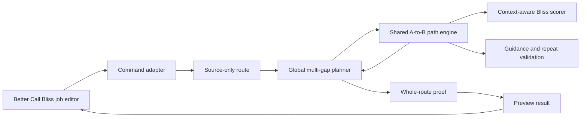
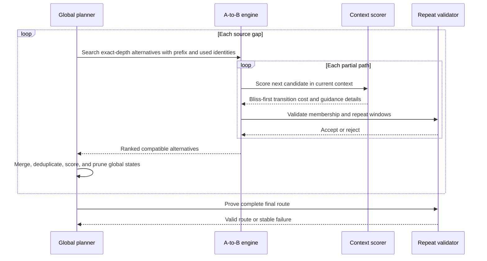

# Global Multi-Gap Playlist Planner

**Status:** Draft for written-spec review  
**Date:** 2026-10-19  
**Owners:** `bliss-playlist-optimizer` and Better Call Bliss  
**First user-facing feature:** Fill every gap with N bridge tracks

## Intent

The first vertical slice adds a strict playlist operation: put exactly `B` generated bridge tracks into every internal gap between source tracks. For `S` source tracks, the result therefore contains exactly `B * (S - 1)` additions. It does not add an introduction before the first source track or an outro after the last one.

Every source track appears exactly once. The user can either preserve the original source order or let Better Call Bliss optimize the order of the source tracks before gap filling begins. In the latter case, that source-only route is frozen before bridges are selected.

The operation is all-or-nothing. It produces a complete route satisfying all hard track, artist, album, membership, and uniqueness constraints, or it produces no result. It must not silently leave gaps empty, use fewer bridges in a difficult gap, or persist a partial playlist.

The implementation introduces a reusable global outer planner. Later policies may allocate a shared budget among difficult gaps or repair structural repeat-window conflicts, but those policies are deliberately outside this first slice.

## Current foundation and problem

The native optimizer already has two useful but separate pieces:

- `search_anchored_paths` is an outer-planner-neutral A-to-B search kernel. It finds alternative paths between two fixed endpoints while applying candidate, beam, repeat-window, and variation controls.
- `select_exact_count_multi_gap_bridges` carries global route, membership, and repeat state across several preserved-order gaps, but it implements an exact total addition count and bypasses the shared anchored-path kernel.

The existing `exact_count` mode can accidentally resemble fixed-per-gap behavior when the total is `B * (S - 1)` and every gap is capped at `B`. That is not a stable contract: the optimizer is still free to distribute the additions unevenly. Better Call Bliss must therefore not implement this feature as a UI calculation layered over `exact_count`.

This design makes fixed gap count explicit, reuses the anchored path engine, and replaces the duplicated multi-gap search logic with a shared global planning layer.

## User experience and contract

Better Call Bliss adds a new **Additional tracks** purpose:

> **Fill every gap with N bridge tracks**

Selecting it reveals one primary value:

- **Bridge tracks per gap**, integer `1..8`.

It remains compatible with both **Source-track order** choices:

- **Preserve source order:** use the playlist or queue snapshot as the anchor order.
- **Optimize source order:** optimize only the source tracks first, freeze that order, and then fill all resulting gaps.

The page shows the derived scope before a run starts: source tracks, internal gaps, bridges per gap, total additions, and final track count. Controls for automatic additions, exact total additions, target length, and endpoint additions are hidden because they do not apply.

The preview groups additions under their source gap so users can understand each local A-to-B route while still seeing the globally validated final sequence.

## Native request and capability contract

The optimizer receives an explicit mode rather than an inferred combination:

```json
{
  "route": {
    "ordering_policy": "preserve_order"
  },
  "extension": {
    "mode": "fixed_gap_count",
    "tracks_per_gap": 2,
    "gap_context_mode": "rolling"
  }
}
```

The schema rejects incompatible amount and target-length fields for this mode. The optimizer derives the total addition count and final length itself; callers do not send a second, potentially contradictory total.

The capability document advertises `fixed_gap_count_v1`. Better Call Bliss exposes the mode only when that capability is present. The existing versioned request schema is extended in a capability-gated, backward-compatible way; existing modes retain their current meanings.

## Architecture



The design has four native responsibilities:

- The command adapter validates `fixed_gap_count`, derives counts, and obtains the source-only route.
- The global planner carries complete route state across all gaps and chooses compatible local alternatives.
- The shared A-to-B engine generates exact-depth alternatives for one gap.
- The whole-route proof independently validates the final route before it is returned.

The existing exact-total multi-gap implementation is subsumed by this planner rather than retained as a second search system. Exact-total behavior may remain as a policy adapter, but shared state expansion, repeat validation, and pruning live in one implementation.

## Context-aware path scoring

The current anchored-path kernel accepts a fixed pairwise scorer. That is sufficient for static weights and for a matrix frozen before a gap search, but it cannot express Rolling Adaptive scoring, where the context changes as a bridge path grows.

The kernel therefore gains a path-scoring abstraction with two adapters:

- **Fixed scorer:** preserves current pairwise behavior and destination-route parity.
- **Contextual scorer:** evaluates the next leg from the evolving route prefix without making the outer planner understand matrix construction.

The configured gap-context mode keeps its current semantics:

- **Frozen Adaptive:** choose the adaptive matrix once from the original context for that gap and use it for all legs in that gap.
- **Rolling Adaptive:** recompute the adaptive view from the evolving accepted prefix for every intermediate leg and for the final leg into the next source anchor.

Candidate discovery remains Bliss-first. Optional guidance can adjust the ordering of acoustically bounded candidates, but it cannot introduce an acoustically ineligible track or override a hard repeat constraint.

## Global planning algorithm

Let the frozen source route be `A0, A1, ... An`. The planner starts with `A0` in the route and marks every source track as unavailable for generated-track selection, preventing a later source anchor from being chosen as a bridge.

For each gap `Ai -> Ai+1`, the planner performs these steps:

1. Expand every retained global state through the shared A-to-B engine at exact depth `B`.
2. Pass the route prefix, used track identities, repeat-window state, scoring context, evidence, and deterministic generation seed into the gap search.
3. Append each locally valid alternative plus `Ai+1` to a copy of the global state.
4. Re-evaluate the complete resulting prefix, then merge, deduplicate, deterministically sort, and prune the global beam.
5. Continue only with globally compatible states.



The global objective is lexicographic:

1. satisfy all hard constraints;
2. minimize the worst generated adjacent transition;
3. minimize the total transition cost;
4. apply bounded optional guidance as a tie-breaking influence within the Bliss-qualified search space;
5. use stable track identities as the final deterministic tie-breaker.

Variation is applied only among complete, near-optimal valid plans. It must not weaken hard constraints, alter the exact number of tracks per gap, or make parallel scheduling observable. Independent state expansions may run through Rayon, followed by a deterministic merge and sort.

## Membership, identity, and repeat windows

The planner uses the same projected identity semantics as other optimizer paths, including MBID-aware artist and recording identities when supplied by the host. It enforces:

- each source track appears exactly once;
- each generated track appears at most once across the entire playlist;
- generated tracks cannot consume a later source anchor;
- artist, album, and track windows cross source-gap boundaries;
- the end of one generated path constrains the beginning of the next;
- source anchors are validated in their final positions, not treated as exemptions.

After planning, an independent final validator replays the entire route and proves membership, uniqueness, source preservation, exact per-gap counts, and repeat-window compliance. Persistence is impossible unless that proof succeeds.

## Fail-fast validation and errors

Cheap structural checks run before expensive candidate discovery:

- at least two source tracks;
- `tracks_per_gap` within `1..8`;
- checked arithmetic for gap, addition, and final-track counts;
- final result no larger than the existing 500-track optimizer limit;
- enough unique eligible candidates for the derived total additions;
- no already-impossible source-anchor artist or album pattern under the requested exact spacing.

The source-anchor preflight projects their final positions, which are `B + 1` tracks apart. It can therefore reject repeat-window combinations that no bridge selection could repair.

Stable error codes are:

- `FIXED_GAP_COUNT_INVALID` for an invalid request;
- `FIXED_GAP_COUNT_TOO_LARGE` for a derived result beyond supported limits;
- `FIXED_GAP_SOURCE_REPEAT_CONFLICT` for an impossible source-anchor pattern;
- `FIXED_GAP_INSUFFICIENT_CANDIDATES` for an inadequate unique candidate inventory;
- `FIXED_GAP_ROUTE_NOT_FOUND` when search exhausts its bounded alternatives without a complete route.

`FIXED_GAP_ROUTE_NOT_FOUND` reports the blocking gap, states evaluated and retained, locally available alternatives, and the dominant rejection reasons. It still returns no partial sequence.

## Results, progress, and cancellation

The result identifies `selection_preview.mode` as `fixed_gap_count` and includes:

- source count and gap count;
- bridge tracks per gap, derived additions, and final count;
- original and, when applicable, optimized source route;
- complete final sequence;
- per-gap endpoints, selected bridges, transition measurements, and guidance traces;
- global states evaluated, retained, and pruned;
- repeat and membership proof summaries;
- deterministic generation and provider provenance.

Progress reports the current gap `i/G`, expanded and retained global states, local alternatives considered, and the active scoring phase. Cancellation is checked between global states and inside bounded A-to-B expansion loops so the plugin can stop work promptly.

## Performance and resource bounds

The planner must remain usable on Raspberry Pi-class hosts and scale to libraries beyond 200,000 tracks. The implementation therefore:

- reuses inventory, transformed-feature, scoring, and provider-preparation caches;
- prepares guidance providers once per job, not once per gap or state;
- never scans the whole library from every gap expansion;
- uses bounded Bliss candidate shortlists before optional guidance;
- stores compact state deltas instead of cloning full heavyweight artifacts;
- parallelizes independent state expansion where it materially helps;
- merges parallel output deterministically;
- records phase timings, peak state counts, and pruning statistics.

The public safety limits remain 500 final tracks and eight generated tracks per gap. Beam and internal shortlist sizes remain implementation controls rather than user-facing tuning knobs.

## Test strategy

### Shared A-to-B engine

- Existing destination-route fixtures retain scoring and route parity through the fixed-scorer adapter.
- Exact-depth search returns multiple deterministic alternatives.
- Frozen and Rolling Adaptive contexts use the expected matrices on every leg.
- Used identities, unavailable source anchors, and repeat windows reject invalid paths.
- Parallel and single-threaded execution produce identical ordered results.

### Global planner

- Three source tracks with `B = 2` produce exactly four additions, two in each gap.
- A locally best first-gap path that blocks the second gap loses to a globally viable alternative.
- Artist and album conflicts spanning a gap boundary are rejected.
- Structurally impossible source anchors fail during preflight.
- Candidate exhaustion and search exhaustion return different stable error codes.
- No failed search returns a partial route.
- Variation changes only complete near-optimal plans and remains reproducible for a fixed seed.
- Preserve and optimize-source-order policies both retain every source exactly once.
- Static, extended isolation forest, learned-matrix, and Adaptive configurations exercise the same planner contract.

### Contract and plugin

- Request-schema, capability, result-artifact, and progress fixtures cover `fixed_gap_count_v1`.
- Legacy request fixtures and existing optimizer modes remain unchanged.
- Better Call Bliss normalizes `tracks_per_gap`, derives the displayed counts, and hides irrelevant controls.
- The UI disables the feature against an older optimizer capability set.
- Request serialization emits native integers and booleans.
- Preview rendering groups bridges by gap and retains guidance explanations.
- Infeasible previews cannot reach playlist or queue output.
- Accepted previews reuse the existing overwrite, copy, and player-queue output paths.

## Delivery slices

The implementation should be delivered in dependency order:

1. Generalize the anchored-path scorer while proving existing destination-route parity.
2. Introduce the global planner and adapt the existing exact-total multi-gap policy to the shared machinery.
3. Add the native `fixed_gap_count` contract, preflight checks, result data, progress, fixtures, and errors.
4. Add Better Call Bliss request building, conditional UX, preview grouping, tests, and user documentation.
5. Benchmark on representative large fixtures and the Pi, then perform coordinated native and plugin release validation.

Each slice must keep existing commands operational and independently testable. The user-facing mode is not advertised until the complete native capability and plugin integration are present.

## Acceptance criteria

The first vertical slice is complete when:

- users can request exactly `1..8` bridges in every internal source gap;
- both source-order policies behave as documented;
- the optimizer returns exactly `B * (S - 1)` additions or no route;
- no opening or closing additions appear;
- all hard membership, uniqueness, and repeat constraints are proven globally;
- Frozen and Rolling Adaptive gap context behave consistently with their current definitions;
- optional guidance remains bounded by Bliss candidate eligibility;
- progress, cancellation, failure diagnostics, and per-gap preview explanations are visible;
- existing destination-route and extension behavior passes unchanged regression tests;
- deterministic runs reproduce identical results across supported thread counts.

## Explicitly deferred

This design does not yet implement:

- variable bridge counts selected independently for each gap;
- automatic distribution of one global bridge budget;
- minimum additions needed to repair repeat-window conflicts;
- introductions or outros outside the source endpoints;
- duration-based per-gap budgets;
- new acoustic analysis features or a changed Bliss feature representation;
- changes to playlist persistence or player-queue publication.

Those policies should become additional command adapters over the same global planner and A-to-B engine, not separate pathfinding implementations.
